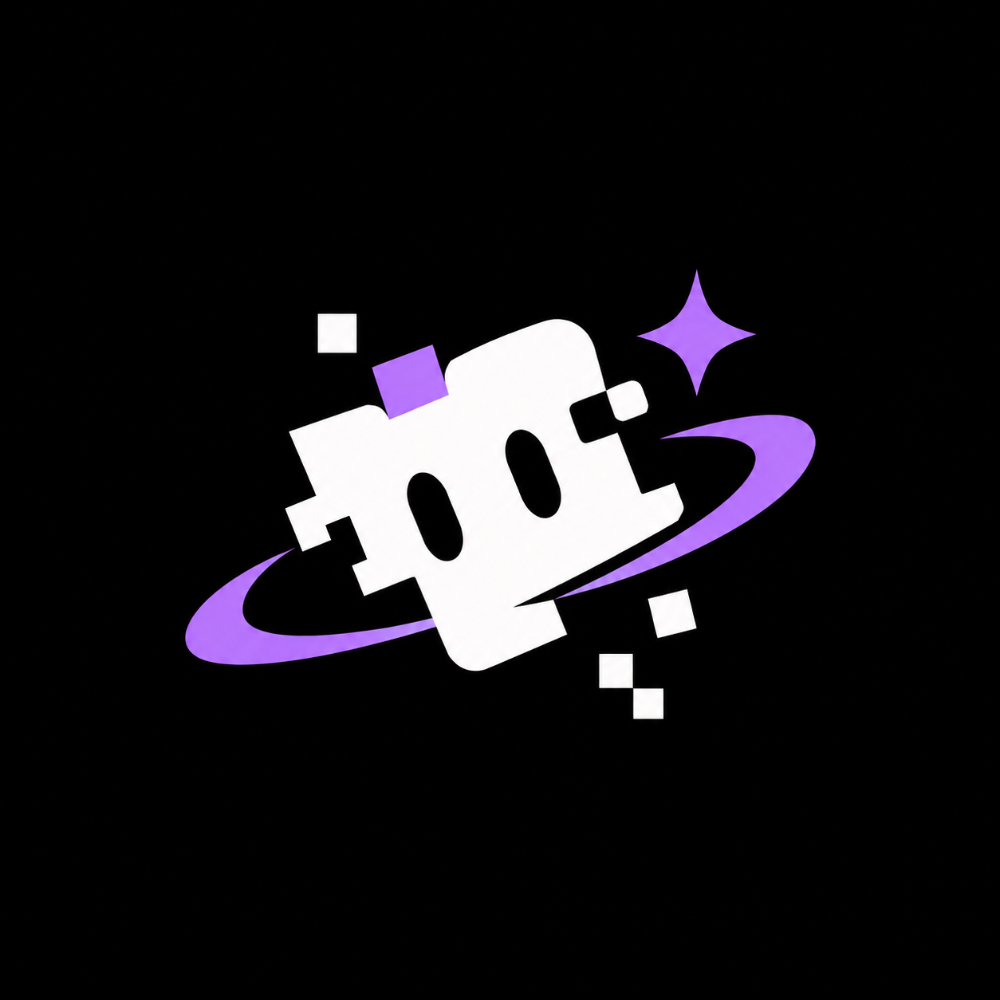

# PixTui



[](https://go.dev/)
[](https://github.com/Gomobra/PixTui/actions/workflows/ci.yml)
[](LICENSE)

**PixTui is a Go library for building terminal user interfaces (TUI).** It provides a component-based rendering model, Yoga-powered layout, interactive terminal widgets, and supporting packages for building full-screen command-line applications.

> The public API and feature coverage may evolve. Check the source and package APIs before relying on a feature in production.

## Highlights

- **Composable renderables** — Build interfaces by nesting components such as boxes, text, inputs, selects, textareas, sliders, tables, and more.
- **Flexbox layout** — Use Yoga-backed layout properties to arrange and size UI elements.
- **Terminal rendering** — Render component trees through a CLI renderer with frame updates, terminal input, and resize handling.
- **Interactive UI** — Work with keyboard and mouse event hooks, focusable elements, and reusable input components.
- **Developer-oriented views** — Display code, Markdown, diffs, line numbers, and scrollable content.
- **Media and graphics** — Use image, video, framebuffer, ASCII-font, and 3D-related packages.
- **Additional tooling** — The repository also contains packages for keymaps, animation, plugins, QR codes, SSH, and an HTTP documentation server.
- **Reactive integrations** — React-style and Solid-style packages are included for declarative UI patterns.

## Components

The renderables package includes components such as:

| Component | Purpose |
|---|---|
| `Box` | Container with optional border and title |
| `Text` | Text content with wrapping, alignment, and truncation options |
| `Input` | Single-line text input |
| `Select` | Selectable options |
| `ScrollBox` | Scrollable content container |
| `Textarea` | Multi-line text editing |
| `Slider` | Numeric value selection |
| `TabSelect` | Tab-style selection |
| `EditBuffer` | Editable text buffer view |
| `TextTable` | Tabular text display |
| `Code` | Code display |
| `Markdown` | Markdown content display |
| `Diff` | Diff-style text display |
| `Image` / `Video` | Media renderables |
| `ASCIIFont` | Text rendered with ASCII-style fonts |
| `FrameBuffer` | Framebuffer-backed content |
| `LineNumber` | Line-number display |
| `ScrollBar` | Scroll position indicator |
| `TextNode` | Text node |

This list is illustrative rather than a promise that every component has identical interaction or API coverage. Refer to `packages/core/renderables` for the current implementation.

## Requirements

- **Go 1.26 or newer** — the module declares `go 1.26.0` in `go.mod`.
- A terminal environment for running the interactive renderer. Some terminal features depend on terminal capabilities.

## Installation

Add the packages you need to an existing Go module. For example:

```bash
go get github.com/Gomobra/PixTui/packages/core/renderables
```

The `core` package will be resolved as a dependency of `renderables` where needed. You can also import other PixTui packages directly from their package paths.

## Quick start

The following example creates a bordered box with a text child and renders one frame:

```go
package main

import (
	"log"

	"github.com/Gomobra/PixTui/packages/core"
	"github.com/Gomobra/PixTui/packages/core/renderables"
)

func main() {
	if err := run(); err != nil {
		log.Fatal(err)
	}
}

func run() error {
	renderer := core.NewCliRenderer(80, 24)
	defer renderer.Destroy()

	renderContext := renderer.Context()
	root := core.NewRootRenderable(renderContext, "root")

	box := renderables.NewBoxRenderable(renderContext, renderables.BoxOptions{
		RenderableOptions: core.RenderableOptions[core.Renderable]{
			ID:      "welcome-box",
			Width:   stringPtr("60"),
			Height:  stringPtr("7"),
			Visible: boolPtr(true),
		},
		Border:      true,
		BorderStyle: "rounded",
		Title:       "PixTui",
	})

	message := renderables.NewTextRenderable(renderContext, renderables.TextOptions{
		RenderableOptions: core.RenderableOptions[core.Renderable]{
			ID:      "welcome-message",
			Width:   stringPtr("56"),
			Height:  stringPtr("3"),
			Visible: boolPtr(true),
		},
		Content: "Hello from PixTui!",
		Wrap:    true,
	})

	box.AddChild(message.Renderable)
	root.AddChild(box.Renderable)

	if err := renderer.Start(); err != nil {
		return err
	}
	if err := renderer.Render(root, 1.0/60.0); err != nil {
		return err
	}

	return renderer.WriteFrame()
}

func stringPtr(value string) *string { return &value }
func boolPtr(value bool) *bool       { return &value }
```

This is a **single-frame example**. For a continuously updating application, use `renderer.Run(root)` or implement an application loop that calls `Render` and `WriteFrame` as appropriate. See `cmd/pixtui-demo` for a larger example of the available renderables and renderer setup.

## Run the demo

From the repository root:

```bash
go run ./cmd/pixtui-demo
```

Run it from an interactive terminal to see the terminal UI. The current demo entry point launches a combined showcase; it does not currently provide separate `hello`, `box`, `text`, or other subcommands.

## Build and test

Clone the repository and build all packages:

```bash
git clone https://github.com/Gomobra/PixTui.git
cd PixTui
go build ./...
```

Run the test suite and static analysis:

```bash
go test ./...
go vet ./...
```

The GitHub Actions workflow runs build, vet, and test checks with Go 1.26 on Ubuntu, Windows, and macOS. See the [CI workflow](.github/workflows/ci.yml) for the exact matrix and commands.

## Repository layout

```text
PixTui/
├── cmd/
│   └── pixtui-demo/       # Demo application
├── packages/
│   ├── core/              # Renderable tree, renderer, and UI primitives
│   ├── native/            # Native terminal, buffer, and layout integration
│   ├── react/             # React-style integration
│   ├── solid/             # Solid-style integration
│   ├── keymap/            # Keyboard binding system
│   ├── animation/         # Animation and timeline utilities
│   ├── plugin/            # Plugin infrastructure
│   ├── qrcode/            # QR code generation
│   ├── ssh/               # SSH server functionality
│   ├── three/             # 3D rendering functionality
│   └── web/               # HTTP documentation server
├── .github/workflows/     # CI configuration
├── go.mod
├── go.sum
└── Makefile
```

## Contributing

Contributions, bug reports, and feature suggestions are welcome.

1. Open an issue describing the bug or proposal.
2. Fork the repository and create a focused branch.
3. Make the change and add or update tests where appropriate.
4. Run `go build ./...`, `go test ./...`, and `go vet ./...`.
5. Open a pull request with a clear description of the change.

## License

Distributed under the MIT License. See `LICENSE` for more information.

## Donate

If you find PixTui useful, consider supporting the project:

- **Bitcoin (BTC):** `bc1qegkxu0cp2r83hne8642afst90l68du05datn3x`
- **TON:** `UQCslWQYJEiaLlw4-Zl3qI4fYL0G0xV6KtIfTel-4pz11Ygt`

## Contact

Gomobra — [@Gomobra](https://github.com/Gomobra)

Project Link: [https://github.com/Gomobra/PixTui](https://github.com/Gomobra/PixTui)

## Links

- [Repository](https://github.com/Gomobra/PixTui)
- [Issues](https://github.com/Gomobra/PixTui/issues)
- [CI workflow](https://github.com/Gomobra/PixTui/actions/workflows/ci.yml)